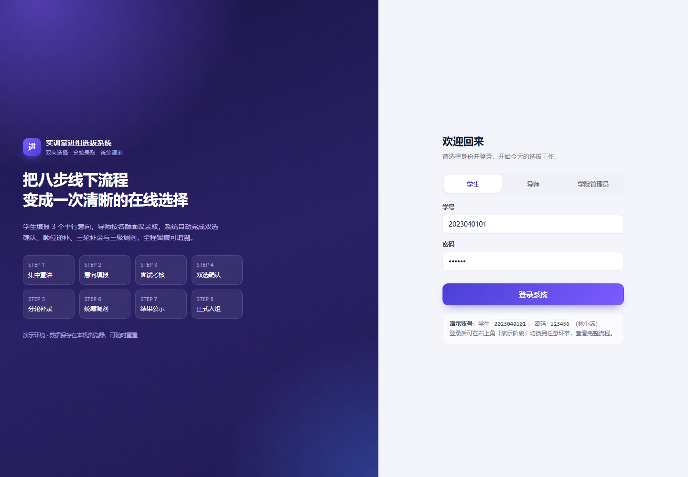
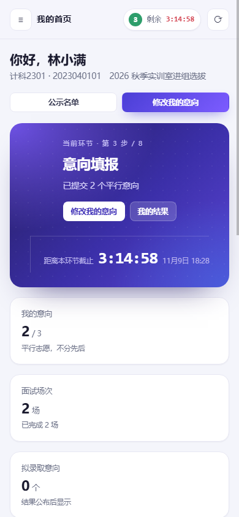
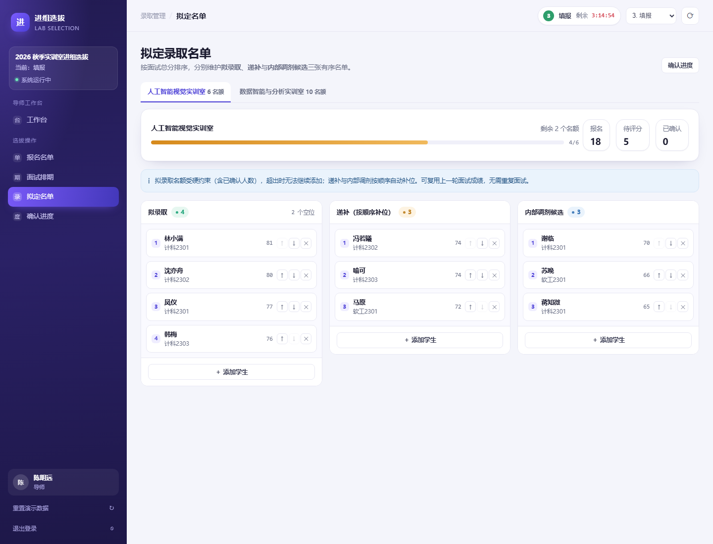
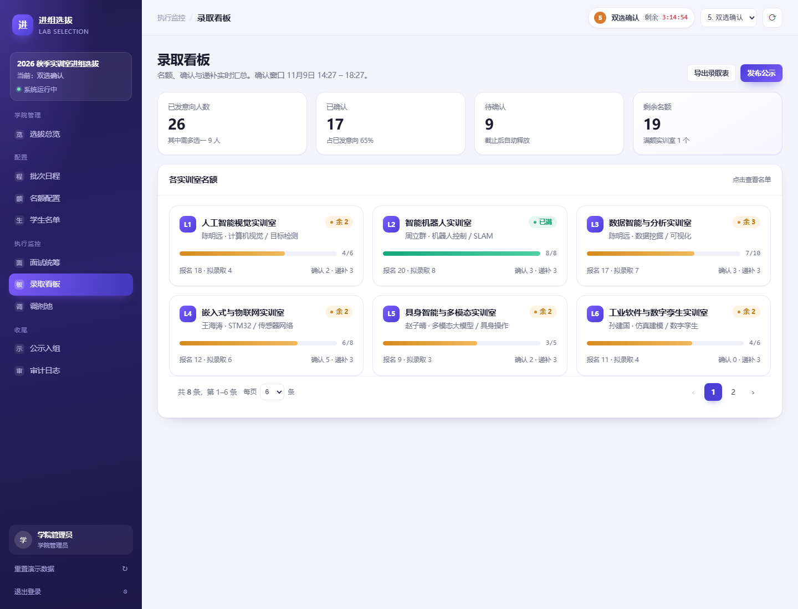

# 实训室进组选拔系统（前后端完整版）

把学院《学生实训室进组选拔流程》的 8 个环节做成可用系统：学生填报 3 个平行意向，导师按名额评分定名单，学院完成双选确认、递补、补录与三级调剂，最后公示入组。

- **前端**：原生 HTML/CSS/JS，无构建、无第三方依赖。
- **后端**：Node.js 原生 `http` + `node:sqlite`（Node 22+ 内置），同样**不需要 npm install**。
- **数据**：SQLite（WAL 模式），事务 + 唯一约束保证名额不超录、确认不重复。



## 快速开始

```bash
node server.js
# 打开 http://127.0.0.1:8123
```

要求 Node.js **22.5+**（本机为 24.x，已验证）。首次启动会自动建库、写入演示数据（`data/app.db`）。

- 换端口：`PORT=8124 node server.js`
- 手机访问：`HOST=0.0.0.0`（默认已是），用电脑局域网 IP 打开 `http://192.168.x.x:8123`
- 重置演示数据：登录后侧边栏「重置演示数据」，或 `npm run db:reset`
- Windows 双击 `start.bat` 也可以一键启动并打开浏览器

> 现在必须通过 HTTP 访问。直接双击 `index.html` 会提示「无法连接后端」，因为浏览器端需要同源 API 与登录 Cookie。

## 演示账号

| 身份 | 账号 | 密码 | 说明 |
|---|---|---|---|
| 学生 | `2023040101` | `123456` | 林小满，双选阶段收到 2 条拟录取，可实际二选一 |
| 导师 | `T102` | `123456` | 陈明远，负责人工智能视觉、数据智能与分析两个实训室 |
| 学院管理员 | `admin` | `123456` | 日程、名额、面试统筹、调剂、公示、日志 |

密码使用 `scrypt` 加盐哈希存储，登录签发 HttpOnly Cookie 会话（12 小时有效）。

## 架构

```
浏览器（原生 SPA + hash 路由）
        │  fetch JSON / Cookie 会话
        ▼
Node HTTP 服务（server/index.js）──静态资源 + /api/*
        │
        ▼
业务规则层（server/rules.js）──阶段窗口 / 名额 / 递补 / 结算
        │
        ▼
SQLite（server/db.js，WAL）──表结构 + 种子数据 + 事务
```

```
index.html            单页外壳
css/app.css           设计系统
js/api.js             fetch 封装
js/store.js           客户端仓库：服务端快照 + 同步读 / 异步写
js/ui.js              分页、弹窗、Toast
js/views-*.js         学生 / 导师 / 学院三端页面
js/data.js            演示数据种子（浏览器与 Node 共用）
js/app.js             hash 路由、导航、倒计时
server/index.js       HTTP 服务、静态资源、Cookie 会话
server/api.js         REST 路由、快照（按角色裁剪）
server/rules.js       时间窗口、名额、递补、结算、审计
server/db.js          SQLite 连接、迁移、种子、备份、重置
server/seed.js        从 js/data.js 生成演示数据
server/migrations/    版本化建表脚本（001_init.sql）
scripts/              db-check / db-reset / db-backup
test/                 数据库约束、接口、界面冒烟测试
data/app.db           运行期数据（首次启动自动生成）
data/backups/         备份目录
```

## API

所有接口返回 JSON；失败返回 `{ "error": "原因" }` 与对应状态码（400 参数、401 未登录、403 越权、404 不存在、409 业务冲突）。

| 方法 | 路径 | 角色 | 说明 |
|---|---|---|---|
| POST | `/api/login` | 公开 | 登录，签发会话并返回快照 |
| POST | `/api/logout` | 公开 | 退出 |
| GET | `/api/bootstrap` | 登录 | 按角色裁剪的完整快照 |
| POST | `/api/applications` | 学生 | 提交/修改 ≤3 个平行意向（仅填报窗口） |
| POST | `/api/confirmations` | 学生 | 二选一确认去向，释放其他意向并触发递补 |
| POST | `/api/interviews/:id/score` | 导师 | 四维评分，提交后锁定 |
| POST | `/api/interviews/arrange` | 导师/学院 | 30 分钟一档智能排期，避让学生冲突 |
| POST | `/api/nominations` | 导师/学院 | 加入拟录取 / 递补 / 内部调剂候选 |
| PATCH | `/api/nominations/:id/move` | 导师/学院 | 名单上移 / 下移 |
| DELETE | `/api/nominations/:id` | 导师/学院 | 移出名单并重排顺位 |
| PATCH | `/api/labs/:id` | 学院 | 调整名额（不得低于已占用） |
| PATCH | `/api/cycle` | 学院 | 修改批次名与 8 个环节时间 |
| POST | `/api/cycle/jump` | 演示环境 | 跳到指定环节（重排时间轴） |
| POST | `/api/cycle/settle` | 学院 | 手动结算（自动确认 / 逾期释放） |
| POST | `/api/allocations` | 学院 | 调剂落位，必须填理由 |
| POST | `/api/publicity` | 学院 | 发布 1 天公示 |
| POST | `/api/objections` | 学生 | 提交异议 |
| POST | `/api/demo/reset` | 演示环境 | 清库重灌种子数据 |
| GET | `/api/export/:kind` | 学院 | 导出 CSV（students/labs/admissions/publicity/audit） |
| POST | `/api/interviews/:id/unlock` | 学院 | 解锁已锁定的面试评分，需重新评分 |

服务端在**每次读写前**自动执行一次结算（幂等），因此「单意向自动确认」「确认窗口结束逾期释放」不依赖前端在线。

## 数据库

- 引擎：Node 内置 `node:sqlite`，单文件 `data/app.db`，WAL 模式，`busy_timeout=5000`。
- 结构：`server/migrations/` 下按序号执行（`001_init.sql` 建表，`002_nomination_deadline.sql` 增加补位确认截止时间），执行记录写入 `schema_migrations`，重复启动不会重复建表。
- 约束兜底：`CHECK` 校验角色/状态枚举与 0–100 分数区间；外键全部开启（`PRAGMA foreign_keys=ON`）；部分唯一索引防止同一实训室出现两条有效名单；触发器 `trg_nomination_capacity_insert/update` 在插入拟录取或递补升级时校验名额，超录直接 `RAISE(ABORT,'名额已满')`。
- 容量视图：`v_lab_capacity` 按「拟录取 ∪ 已确认 ∪ 已调剂」去重统计占用，页面与接口共用同一口径。
- 旧库兼容：检测到没有 `schema_migrations` 的旧结构时，先 `VACUUM INTO data/legacy-<时间戳>.db` 备份，再重建并灌入演示数据。

常用命令：

| 命令 | 作用 |
|---|---|
| `npm start` | 启动服务（默认 http://127.0.0.1:8123） |
| `npm run db:check` | 完整性、外键、结构版本、各表行数 |
| `npm run db:reset` | 软重置：清空业务数据并重灌种子，保留表结构 |
| `npm run db:reset:hard` | 删库重建：重新跑迁移 |
| `npm run db:backup` | `VACUUM INTO` 备份到 `data/backups/` |
| `npm test` | 数据库约束 + 接口 + 界面三组冒烟测试 |

健康检查：`GET /api/health` 返回结构版本、各表行数、`integrity_check` 结果与外键异常数，可直接接监控。

更细的表结构、迁移流程、备份恢复与常用 SQL 见 **[docs/DATABASE.md](docs/DATABASE.md)**。

## 数据表

`users`（学生/导师/学院，含 scrypt 哈希）、`sessions`、`cycle`、`stages`、`labs`、`applications`、`application_labs`、`application_versions`、`interviews`、`nominations`、`confirmations`、`allocations`、`publicity`、`objections`、`audit`、`meta`。

关键约束：

- `confirmations.student_id` 主键 —— 一名学生只能有一个去向（R2）。
- `interviews (lab_id, student_id)` 唯一 —— 不存在重复面试。
- 名额计算用「拟录取 ∪ 已确认 ∪ 已调剂」去重后的学生数（R4），写操作在 `BEGIN IMMEDIATE` 事务内完成。

## 规则落在哪

| 规则 | 实现位置 |
|---|---|
| R1 平行意向、≤3、不排序 | `api.saveApplication` + `application_labs.position` |
| R3 全量面试、未评分不录取 | 评分接口 + 名单仅从评分排序生成（前端亦禁止未评分加入） |
| R4 名额硬约束 | `rules.remaining/takenCount` 在事务内校验，超录返回 409 |
| R6 窗口修改、版本留痕 | `application_versions` 保存每次旧版本 |
| R7 单意向自动确认 | `rules.settle` |
| R8 多意向二选一 | `rules.confirmOffer` |
| R9 逾期释放 | `rules.settle`（窗口结束 + 补位 2 小时到期，两个口径分开处理） |
| R10 递补补位 | `rules.promote`：确认释放、逾期释放、移除名单后都会自动递补，写入 `nominations.deadline = now + 2h` |
| R14/R15 三级调剂 | `api.allocate`（P1/P2/P3，理由必填） |
| R17 幂等/并发 | SQLite 事务 + 主键/唯一约束；重复确认返回 409 |
| R19 公示脱敏 | 快照中 `publicRows` 仅返回姓名 + 学号后四位 |
| R20 审计留痕 | `audit` 表，所有写操作记录操作者、角色、动作、详情 |

## 验证记录

- 接口层：错误密码、4 个意向、越权评分、跨室操作、名额已满、重复确认、过早公示、名额低于占用 —— 均按预期返回 400/401/403/409。
- 容量链路：L1 依次加入至 6/6，第 3 次返回「名额已满（6/6）」。
- 双选链路：学生 2 条意向 → 确认 L3 → 另一条 `released` → 再确认返回 409。
- 前端链路（无头 Chrome）：登录 → 23 条路由全量渲染 → 填报 3 个意向落库 → 跳转双选 → 二选一确认 → 导师评分 78 分锁定 → 学院看板/审计，全程 0 个 JS 报错。
- 数据持久化：重启服务后数据仍在（SQLite 文件）；重置接口可恢复演示数据。
- 接口层：`npm run test:api` 31/31 通过（自动拉起临时服务与临时库，覆盖登录、填报、评分锁定与解锁、双选确认、公示、调剂、CSV 导出、登录限流、递补 2 小时截止、重置）。
- 数据库层：`npm run test:db` 8/8 通过（名额触发器、外键、评分 CHECK、调剂理由 CHECK、部分唯一索引、递补升级触发器、迁移幂等、完整性）。
- 界面层：`npm run test:ui` 6/6 通过（无头 Chrome 打开 5 个关键页面，渲染正常且无 JS 报错）。
- 本机注意：PowerShell 执行策略可能禁用 `npm.ps1`，改跑 `npm.cmd test` 或直接 `node test/api-smoke.js`。

## 演示数据与深链

60 名学生、8 个实训室、55 个名额、97 场面试，预置部分名单（有的满员、有的留 2–3 个空位）。

```
http://127.0.0.1:8123/?as=student&stage=4#/s/result
http://127.0.0.1:8123/?as=teacher#/t/nominations/L1
http://127.0.0.1:8123/?as=admin#/a/allocate
```

`as=` 免登录直达（会真实调用登录接口），`stage=0–7` 切换演示环节。

## 上线前还要补的

1. **HTTPS 与反向代理**：Nginx 终止 TLS，`proxy_set_header X-Forwarded-*`，Cookie 加 `Secure`。
2. **登录限流**：已做进程内限流（同 IP + 账号 5 次/5 分钟），多实例部署时需换成 Redis 等共享计数。
3. **审计不可篡改**：当前可删库；正式环境建议日志外送或只读副本。
4. **备份**：SQLite 定时 `VACUUM INTO` 或文件级快照，保留 ≥30 天。
5. **并发压测**：截止瞬间 500 并发提交/确认，验证 P95 与零超录。
6. **邮件/短信通知**：当前仅站内状态，未接通道。
7. **多实例与读扩展**：SQLite 适合单机；并发更高时换 PostgreSQL，表结构与迁移脚本可平移。

## 下一步

- 接入学校统一身份认证（替换 `users` 密码登录）。
- 导出正式名册（xlsx 盖章版）与公示 PDF。
- 补录轮次的在线填报页面（后端表结构已预留 `round`）。




