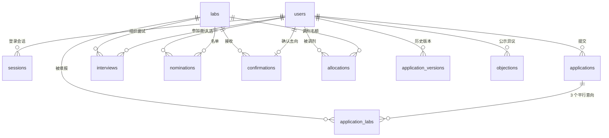

# 数据库设计说明

系统使用 **SQLite**（Node 内置 `node:sqlite`，WAL 模式），零外部依赖。

- 数据文件：`data/app.db`（可用 `DB_PATH` 环境变量覆盖）
- 结构版本：`schema_migrations` 表，迁移文件在 `server/migrations/`
- 连接参数：`journal_mode=WAL`、`foreign_keys=ON`、`busy_timeout=5000`、`synchronous=NORMAL`

## 一、实体关系



## 二、表说明

| 表 | 作用 | 关键字段 |
|---|---|---|
| `users` | 三类账号（学生/导师/学院） | `id`、`role`、`name`、`cls`、`salt`、`password_hash` |
| `sessions` | 登录会话 | `token`（PK）、`user_id`、`expires_at` |
| `cycle` | 选拔批次（单行） | `id=1`、`name`、`year` |
| `stages` | 8 个环节的时间窗 | `idx`（0–7）、`start_at`、`end_at` |
| `labs` | 实训室与名额 | `id`、`quota`、`teacher_id`、`tags`、`requirements` |
| `applications` | 学生本次填报 | `student_id`（PK）、`internal`、`cross`、`version` |
| `application_labs` | 平行意向（≤3，无先后） | `(student_id, lab_id)`、`position` |
| `application_versions` | 每次修改前的快照 | `labs`（JSON）、`internal`、`cross` |
| `interviews` | 面试与四维评分 | `(lab_id, student_id)` 唯一、`status`、`total` |
| `nominations` | 拟录取 / 递补 / 内部调剂候选 | `type`、`rank`、`status` |
| `confirmations` | 学生最终去向（一人一条） | `student_id`（PK）、`source` |
| `allocations` | 统筹调剂记录 | `priority`（P1/P2/P3）、`reason` |
| `publicity` | 公示（单行） | `published_at`、`until` |
| `objections` | 公示异议 | `student_id`、`text`、`status` |
| `audit` | 全量操作留痕 | `actor`、`role`、`action`、`detail` |

## 三、约束与保障

### 唯一性与外键

- `confirmations.student_id` 主键 → 一名学生只有一个去向。
- `interviews (lab_id, student_id)` 唯一 → 不重复安排面试。
- `nominations (lab_id, student_id) WHERE status IS NULL` 部分唯一索引 → 同一实训室只能有一条有效名单。
- `application_labs (student_id, position)` 唯一 → 位置不可重复。
- 所有业务表外键指向 `users` / `labs`，`ON DELETE CASCADE`（学生数据）或 `RESTRICT`（导师删除受保护）。

### CHECK 约束

- 角色、名单类型、确认来源、调剂优先级、异议状态的枚举校验。
- 评分四维与总分 `BETWEEN 0 AND 100`。
- `quota >= 0`、`rank >= 1`、`version >= 1`、`round >= 1`。
- `stages.end_at > start_at`、`publicity.until > published_at`。
- `applications.internal/cross IN (0,1)`。
- `tags` / `requirements` / `labs(JSON)` 通过 `json_valid()` 校验。

### 视图与触发器

```sql
-- 实际占用：拟录取 ∪ 已确认 ∪ 已调剂，按学生去重
SELECT * FROM v_lab_capacity;
```

- `trg_nomination_capacity_insert`：插入拟录取前检查 `quota <= taken`，超录直接 `RAISE(ABORT, '名额已满')`。
- `trg_nomination_capacity_update`：递补把 `wait` 升级为 `accept` 时同样受名额约束。

> 应用层已经做了容量校验，触发器是**数据库层兜底**：即使绕过 API 直接写库，也不会超录。

## 四、迁移

- 目录：`server/migrations/`，文件名 `NNN_描述.sql`，按序号执行。
- 启动时自动应用未执行文件，并写入 `schema_migrations`。
- 新增结构变更：新建 `002_xxx.sql`，重启服务即可；不要修改已应用的迁移文件。

命令：

```bash
npm run db:check        # 完整性 / 外键 / 版本 / 各表行数
npm run db:reset        # 软重置：清空并重灌演示数据
npm run db:reset:hard   # 硬重置：删库后按迁移重建
npm run db:backup       # VACUUM INTO 一致性备份到 data/backups/
```

## 五、备份与恢复

**备份**（在线安全）：

```bash
npm run db:backup
# data/backups/app-20261109-170501.db
```

**恢复**：

1. 停止服务；
2. 删除 `data/app.db`、`data/app.db-wal`、`data/app.db-shm`；
3. 把备份文件复制为 `data/app.db`；
4. 重新启动。

建议每天定时备份，保留 30 天；SQLite 单文件可直接拷贝，但**必须用 `VACUUM INTO` 或先停服**，否则可能拿到不一致快照。

## 六、常用查询

```sql
-- 各实训室名额占用
SELECT lab_name, quota, taken, quota - taken AS remaining FROM v_lab_capacity ORDER BY lab_id;

-- 尚未确定去向的学生
SELECT u.id, u.name FROM users u
WHERE u.role = 'student'
  AND NOT EXISTS (SELECT 1 FROM confirmations c WHERE c.student_id = u.id)
  AND NOT EXISTS (SELECT 1 FROM nominations n WHERE n.student_id = u.id AND n.type = 'accept' AND n.status IS NULL);

-- 待评分面试
SELECT l.name, u.name, i.at FROM interviews i
JOIN labs l ON l.id = i.lab_id JOIN users u ON u.id = i.student_id
WHERE i.status = 'pending';

-- 审计回溯
SELECT at, actor, action, detail FROM audit ORDER BY at DESC LIMIT 50;
```

## 七、常见问题

| 现象 | 处理 |
|---|---|
| `database is locked` | 确认没有重复启动服务；WAL 模式下允许一写多读，异常退出后重启即可 |
| 端口被占用 | `PORT=8124 node server.js`，或结束占用进程 |
| 结构升级后报字段错误 | `npm run db:reset:hard`（会清空演示数据） |
| 旧版本数据库 | 首次启动会自动备份为 `data/legacy-*.db` 并按迁移重建 |
| 文件很大 | WAL 未 checkpoint：正常停服会自动 `wal_checkpoint(TRUNCATE)`；也可运行 `PRAGMA wal_checkpoint` |
| 想换库位置 | `DB_PATH=D:/data/lab.db node server.js` |

## 八、容量与并发

- 单文件 SQLite 足够支撑数百人规模的选拔（本项目演示 60 人/97 场面试）。
- 写操作统一走 `BEGIN IMMEDIATE` 事务，避免并发写冲突；读多写少的场景性能充足。
- 若并发增长到数千人同时截止提交，可迁移到 PostgreSQL：表结构与约束可原样保留，仅需替换连接层。
