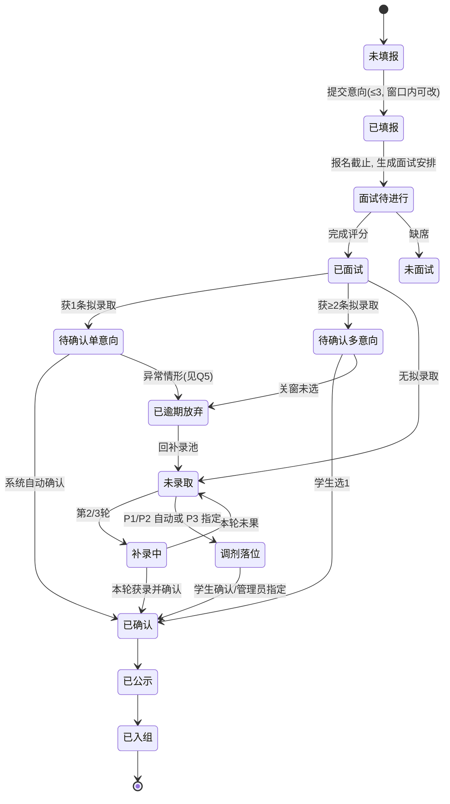

# 实训室进组选拔系统 PRD

> 版本：v1.0（草案）　编写依据：学院《学生实训室进组选拔流程》流程图 + 老师口述需求
> 一句话定位：把「宣讲 → 开放日 → 意向填报 → 面试 → 双选确认 → 三轮补录 → 统筹调剂 → 公示入组」这条线下流程，做成一个**学生、导师、学院三方各自在线操作、规则自动执行、全程留痕**的选拔系统。

---

## 0. 流程依据（原文拆解）

| # | 环节 | 时间窗口 | 关键约束（来自流程图原文） |
|---|---|---|---|
| 1 | 集中宣讲 | 10月29日 14:00 | 学院统一组织；各实训室介绍方向、招录名额、培养安排、考核要求 |
| 2 | 实训室开放日 | 10月29日—10月30日 | 学生实地走访，与导师、高年级学生交流 |
| 3 | 意向填报 | 11月2日 08:00–12:00 | 最多 3 个平行导师意向，**不分配志愿先后**；同时选择是否服从①实训室内部调剂 ②全院跨实训室调剂 |
| 4 | 导师初选与面试考核 | 11月2日 12:00—11月3日 17:00 | 以实训室为单位统一面试；**无论报名是否满额，所有报名学生均须面试**；考察学习态度、逻辑思维、编程基础、沟通表达；产出拟录取名单、递补名单、内部调剂候选名单 |
| 5 | 拟录取与学生确认 | 11月4日 08:00–12:00 | **仅 1 个**意向 → 自动确认；**≥2 个** → 学生在时限内自主选择唯一去向；**逾期未确认视为放弃**，空出名额按递补顺序补位 |
| 6 | 分轮补录 | 11月4日 12:00—11月5日 17:00 | 公布剩余名额；未录取学生重新填报；实训室再组织面试；双向确认与顺位递补；依次完成**第二轮、第三轮** |
| 7 | 统筹调剂录取 | 11月6日 08:00–12:00 | 剩余名额进全院调剂池；优先级：①实训室内部调剂 → ②全院跨实训室调剂 → ③未服从调剂者作最终统筹安置 |
| 8 | 结果公示与正式入组 | 公示 1 天 | 学院汇总最终名单并公示；无异议后正式入组，开展 AI+PB 项目实训 |

**范围**：覆盖上述 8 个环节的线上化（含名单导入、名额管控、递补、调剂、公示、导出）。
**不在范围**：视频面试、在线笔试判题、导师科研成果展示站、与教务系统实时对接（用 Excel 导入替代）。

---

## 1. 项目概述

- **一句话目标**：让学院在不增加人手的情况下，用一套网页系统完成一届实训室进组选拔，做到「志愿不退档、名额不超录、确认有倒计时、递补有顺序、调剂有优先级、结果可追溯」。
- **痛点（线下现状）**：
  1. 意向靠群里接龙/表单收集，3 个平行志愿与两个调剂勾选项容易漏填，后期对不上账；
  2. 面试窗口只有 1 天半，多室报名学生的面试时间互相撞车，靠人肉协调；
  3. 双选确认阶段「谁还没确认、谁已逾期、这个空位该补谁」全靠 Excel 手工维护，极易超录或漏补；
  4. 三轮补录 + 两级调剂规则复杂，手工执行顺序错一次就会产生争议，且没有留痕。
- **完成后的形态**：响应式 Web 系统（手机端优先），学生/导师/学院三端登录使用，数据存校内服务器，最终一键导出录取名册与公示页。

---

## 2. 目标用户与权限

### 2.1 角色

| 角色 | 典型人数（默认假设，待确认） | 核心诉求 |
|---|---|---|
| 学生（候选人） | 300–800 | 手机上 3 分钟填完意向；随时看到自己在哪一步、还剩多少时间、结果是什么 |
| 导师 / 实训室负责人 | 30–60 | 快速看到报名名单、排面试、打分、按名额排出拟录取与递补顺序 |
| 学院管理员（教务/选拔工作组） | 2–5 | 配日程、控名额、盯进度、处理逾期与调剂、发公示 |
| 系统管理员 | 1 | 账号、权限、备份、日志 |
| 学院领导（只读） | 若干 | 看汇总看板与最终名单 |

### 2.2 权限矩阵

| 功能 | 学生 | 导师 | 学院管理员 | 领导（只读） |
|---|---|---|---|---|
| 查看本室报名名单 | 仅自己 | 本室 | 全院 | 汇总 |
| 填报/修改意向 | 本人，窗口内 | — | 代填需授权+留痕（默认关闭） | — |
| 面试排期 | 查看本人 | 本室时段 | 全院统筹、冲突处理 | — |
| 打分 | — | 本室面试学生 | 抽查/解锁 | — |
| 拟录取/递补排序 | — | 本室，受名额硬约束 | 全院查看、异常干预（留痕） | — |
| 确认去向 | 本人 | 查看确认进度 | 查看+逾期处理 | — |
| 调剂分配 | 查看结果 | 参与内部调剂 | 全院调剂池、优先级分配 | 查看 |
| 发布公示 | — | — | 是 | 查看 |
| 导出名册 | — | 本室 | 全院 | 全院 |

> 权限原则：导师只能看到「报了自己实训室」的学生信息；学生之间互不可见；所有越权访问返回 403 并记日志。

---

## 3. 核心功能

按流程图 8 步一一对应，另加 1 组系统支撑能力。

### F1 宣讲与信息发布（对应环节 1）
- 发布宣讲会时间地点（10/29 14:00）、议程、直播/回放链接（可选）。
- 实训室信息页：方向、名额、培养安排、考核要求、导师简介、开放日时段。
- 学生端首页展示**当前环节 + 倒计时**，未开始/已结束状态自动切换（不靠人工改文案）。
- 附件下载：选拔办法、评分标准说明。

### F2 开放日（对应环节 2）
- 展示各室开放时段、地点、可接待人数。
- 可选：学生预约时段 + 现场扫码签到（用于统计到访，**不作为录取依据**，默认关闭，见 §10）。

### F3 意向填报（对应环节 3）
- 窗口：11/2 08:00–12:00，服务器时间到点自动开/关，前端倒计时 + 截止后只读。
- 表单：
  - 从实训室列表选 **≤3 个平行意向**（多选卡片，**不排序、无第一志愿概念**，界面明确写「各意向地位相同」）；
  - 两个必填单选：是否服从**实训室内部调剂**、是否服从**全院跨实训室调剂**（默认不勾选，必须显式选择，防止"被服从"）；
  - 选填：一句话自我介绍 / 作品链接（≤200 字 + 单文件 ≤10MB，可关）。
- 提交前二次确认页：列出所选意向 + 两个调剂选项，提示「提交后本轮不可更换实训室，截止前可修改」。
- 窗口内可重复修改，**以最后一次提交为准**；每次提交留版本记录（时间、IP、内容快照）。
- 截止后系统锁定，填报期结束自动生成各室报名名单。
- 校验：少于 1 个不能提交；超过 3 个禁止勾选第 4 个；重复实训室去重；未勾选调剂项不允许提交（但允许选「不服从」）。

### F4 面试与评分（对应环节 4）
- **强制全量面试**：系统不允许「报名数 < 名额」时跳过面试或自动录取，名单页对未安排面试的学生高亮「待排期」。
- 面试排期：
  - 导师按「日期 + 时段 + 地点 + 评委」建时段，学生入座；
  - 学生视角的**冲突检测**：同一学生的多个意向被排在同一时段 → 系统标红并阻止保存，提示学院统筹；
  - 学院端提供「一键按意向分组生成建议时段」，导师确认后生效（应对 11/2 12:00 填报截止后 1 天内完成面试的强时限）。
- 评分表（4 维度，百分制，权重可配，默认学习态度 25 / 逻辑思维 30 / 编程基础 25 / 沟通表达 20）：
  - 支持多位评委独立打分，汇总取平均（可选去极值）；
  - 评委提交后锁定，不可自改，需学院解锁并留痕；
  - 缺席/未参加面试 → 标记「未面试」，本轮不进入拟录取。
- 名单产出（导师端，三张有序列表）：
  - **拟录取**：数量 ≤ 该室剩余名额，超出时按钮禁用（后端同样拒绝）；
  - **递补名单**：拖拽排序，必须连续编号，允许为空；
  - **内部调剂候选**：仅当学生勾选了"服从内部调剂"才可加入，按顺位排序。

### F5 双选确认（对应环节 5）
- 11/4 08:00 开放，12:00 关窗。
- 学生「我的结果」页：
  - 0 条意向：显示「未获拟录取，可参加补录」，并给出补录开放时间倒计时；
  - 1 条意向：**系统自动确认**，页面显示「已自动确认至 XX 实训室」，无需点击（通知里说明规则，避免学生以为漏操作）；
  - ≥2 条：卡片式并列展示各室名称/方向/导师/名额，选择其一 → 二次确认弹窗（含"放弃其余意向"的后果说明）→ 锁定。
- 确认后状态锁定不可反悔；如需变更只能由学院在公示前人工调整并留痕（默认不开放）。
- 关窗时未确认 → 批量标记「逾期放弃」，系统自动：释放名额 → 按递补顺位补位 → 通知被补位学生（确认窗口顺延至 11/4 12:00 前，见 R10）→ 被放弃学生回到"未录取池"。
- 学院端确认看板：已确认 / 待确认 / 已逾期 / 递补进行中 四色计数，可导出未确认名单催办。

### F6 分轮补录（对应环节 6）
- 窗口 11/4 12:00–11/5 17:00，系统内配置「第二轮」「第三轮」两个子轮次（时长可调，默认各半天）。
- 每轮固定四步：**公布剩余名额 → 未录取学生填报（仍最多 3 个、仍不排序）→ 实训室面试（可复用上一轮已面试成绩，需导师显式选择"免面试直接排序"）→ 确认（规则同 F5，含自动确认/多选一/逾期放弃/递补）**。
- 只允许填报**仍有剩余名额**的实训室；名额为 0 的实训室灰显并标注「已满」。
- 已确认学生不参与补录；每轮结束自动结转名单并生成轮次快照。

### F7 统筹调剂（对应环节 7）
- 11/6 08:00–12:00，三轮结束后把全部剩余名额锁入「全院调剂池」，同时冻结导师自主录取。
- 系统按三级优先级生成**建议名单**（严格串行，前一级处理完才进入下一级）：

  | 优先级 | 对象 | 系统动作 |
  |---|---|---|
  | P1 实训室内部调剂 | 勾选了"服从内部调剂"的未录取学生 + 本室"内部调剂候选"名单 + 本室仍有空位 | 按候选顺位自动落位 |
  | P2 全院跨实训室调剂 | 勾选了"服从全院调剂"的未录取学生 | 按「面试总分降序 → 学号升序」自动匹配空位，同分可复现 |
  | P3 最终统筹安置 | 未勾选任何调剂（或 P1/P2 后仍未落位）的学生 | **不自动分配**，由学院管理员逐人指定去向 + 填写理由（避免程序化分配引发争议），生成待确认记录 |

- 管理员可对每一条建议执行「采纳 / 调整 / 驳回（写理由）」，全部操作留痕；支持一键生成调剂结果通知。
- 调剂同样受名额上限约束，落位后名额实时扣减。

### F8 公示与入组（对应环节 8）
- 一键发布公示：页面展示 姓名 + 学号后 4 位 + 录取实训室 + 录取方式（正常/递补/内部调剂/跨室调剂/统筹），**不公示分数与排名**。
- 公示期 1 天（可配精确到时分），期间开放「异议提交」表单（匿名/实名可选，写入后台待办，线下处理结论回填系统）。
- 公示结束：锁定名单 → 导出正式名册（Excel + PDF 盖章版）→ 生成入组名单与实训室分组表 → 通知学生入组时间地点 → 归档批次数据。

### F9 系统支撑
- **批次（Cycle）概念**：一次选拔 = 一个批次，含 8 个可独立开关/配时的环节；支持复制上一批次配置，下一年直接改日期。
- 名单导入：学生（学号/姓名/班级/联系方式）、实训室与名额（名称/方向/导师/名额）用标准 Excel 模板导入，带校验与错误行回显。
- 通知中心：站内信 + 邮件（默认），模板可编辑；节点见 §8.3。
- 审计日志：所有写操作记录 操作者/时间/IP/前值/后值/理由，不可删改，可导出。
- 数据看板：各室报名数、面试完成率、拟录取数、确认率、剩余名额、志愿满足率（1/2/3 志愿命中）、最终录取率。
- 峰值保护：截止前 10 分钟、确认关窗前 10 分钟是高并发点，见 §7。

---

## 4. 关键业务规则（可验收的硬约束）

> 每条都对应验收用例（§9.2），开发实现时按编号回溯。

| 编号 | 规则 |
|---|---|
| R1 | 意向平行：≤3 个，**不排序**；系统任何环节不得因选择顺序影响面试机会与录取结果；同一学生可同时获得多个拟录取意向。 |
| R2 | 唯一结果：一名学生在一个批次内只能有 1 个最终去向；状态单向流转，不可回退（管理员重置需留痕并写明理由）。 |
| R3 | 全量面试：报名数 < 名额时仍须全部面试；系统禁止"未面试直接拟录取"。 |
| R4 | 名额硬约束：任一实训室「已确认 + 有效拟录取 + 调剂落位」人数始终 ≤ 名额；DB 唯一约束 + 事务行锁保证，并发下永不超录。 |
| R5 | 时间权威：以服务器时间（NTP 同步）为准；到点自动开关窗；填报表单在服务端二次校验时间，前端绕过无效。 |
| R6 | 修改规则：窗口内可多次修改，以最后一次提交为准；每次提交留存快照；截止后不可改。 |
| R7 | 单意向自动确认：仅 1 条拟录取 → 系统自动确认并通知，学生无需操作。 |
| R8 | 多意向自主确认：≥2 条 → 学生选 1 个，选择即锁定；**不允许同时保留两个**。 |
| R9 | 逾期放弃：确认关窗未操作 → 标记「逾期放弃」，释放名额，学生回未录取池，可参加补录；放弃不可撤销。 |
| R10 | 递补补位：名额释放时按递补顺位自动补位，只补「当前未录取 + 未确认他处 + 未逾期放弃本室」的学生；补位学生的确认截止 = min(本轮窗口结束, 补位时刻 + 2 小时)。 |
| R11 | 补录轮次：第二、三轮共用 11/4 12:00–11/5 17:00；每轮四步（公布名额→填报→面试→确认）独立留痕；可复用上一轮面试成绩，但需导师显式勾选。 |
| R12 | 补录资格：仅「未录取」学生可填；已确认学生不得进入后续任何轮次。 |
| R13 | 调剂池：三轮结束后剩余名额全部进池，导师自主录取权限冻结。 |
| R14 | 调剂优先级：P1 内部 → P2 跨室 → P3 统筹，严格按序；同优先级排序为「面试总分降序 → 学号升序」（可配置，须可复现）。 |
| R15 | 统筹安置：P3 仅覆盖「未勾选任何调剂」或前两级仍落空的学生，由管理员逐人指定并写理由，系统不自动分配。 |
| R16 | 勾选决定路径：只勾内部 → 仅本室调剂；只勾跨室 → 仅跨室调剂；都不勾 → 只能靠本人志愿录取，不进调剂池。 |
| R17 | 幂等与并发：确认/递补/调剂接口带幂等键；同一学生重复点击只生效一次；并发抢最后 1 个名额时仅 1 人成功，其余收到明确提示。 |
| R18 | 通知可达：结果发布、确认开启、截止前 1 小时、逾期、补录开启、公示发布 → 至少站内 + 邮件双通道；发送失败重试 3 次并记录。 |
| R19 | 公示脱敏：只展示姓名 + 学号后 4 位 + 去向 + 录取方式；不展示分数、排名、其他意向。 |
| R20 | 全程留痕：任何状态变更记录操作者/时间/IP/前值/后值/理由；日志只增不改，可导出备查。 |

### 4.1 学生状态机



### 4.2 实训室状态机

`未开放 → 报名中 → 面试中 → 名单待确认 → 已满 / 未满 → 补录中 → 调剂中 → 已封存`

---

## 5. 页面 / 模块结构

### 5.1 学生端（H5，移动优先，路由 `/s/*`）

| 页面 | 要点 |
|---|---|
| S1 登录 | 学号 + 初始密码（首次登录强制改密）；忘记密码走邮件/管理员重置 |
| S2 首页 | 当前环节卡片 + 倒计时 + 我的待办（该填的、该确认的、该看的） |
| S3 实训室列表 | 方向、名额、剩余名额进度条、开放日时段；搜索/筛选 |
| S4 实训室详情 | 培养安排、考核要求、导师简介、报了哪些人（默认不展示，避免从众） |
| S5 意向填报 | 3 选多卡、两个调剂开关、预览页、修改记录入口 |
| S6 面试安排 | 时间地点/评委、冲突提示、请假说明（不影响流程） |
| S7 结果与确认 | 拟录取卡片、倒计时、单选、二次确认弹窗、逾期后果提示 |
| S8 补录填报 | 仅显示有余额的实训室、显示本轮剩余名额 |
| S9 调剂结果 | 优先级来源说明（P1/P2/P3 分别怎么来的） |
| S10 公示与异议 | 脱敏名单、异议表单、公示剩余时间 |
| S11 入组须知 | 报到时间地点、需准备材料、常见问题 |

### 5.2 导师端（`/t/*`）

T1 实训室资料与名额 → T2 报名名单（可导出、看调剂勾选）→ T3 面试排期 → T4 评分（批量录入、锁定）→ T5 拟录取/递补/内部调剂三张有序表 → T6 确认进度看板 → T7 补录与调剂参与 → T8 本室统计。

### 5.3 学院管理端（`/admin/*`）

A1 批次与日程配置（8 环节开关 + 时间 + 时区）→ A2 实训室与名额总表 → A3 学生名单导入 → A4 面试统筹（全局冲突检测、统一场地）→ A5 实时看板 → A6 逾期与递补处理 → A7 补录轮次管理 → A8 调剂池（优先级队列、批量分配、理由必填）→ A9 公示与异议 → A10 名册导出与归档 → A11 审计日志与权限 → A12 通知模板。

---

## 6. 设计与体验要求

- **视觉**：沿用流程图的蓝紫渐变 + 白色卡片 + 圆形编号徽章（1–8）+ 胶囊状时间标签，让线上页面与学院公示的流程图"长得一样"，降低学生理解成本。
- **信息层级**：每页顶部固定一条「当前环节 + 距离截止 X 小时 Y 分」状态条；截止前 1 小时变强调色（不仅靠颜色，配图标与文字）。
- **反馈**：提交、确认、放弃、删除等操作必须有二次确认；成功后给出「你已经完成什么、接下来会发生什么」两句话，而不是简单 toast。
- **适配**：360–430px 手机为主，≥1024px 桌面为辅；表格在移动端转卡片；关键按钮固定在底部安全区上方。
- **可访问性**：正文 ≥16px，正文对比度 ≥4.5:1；不单独用红/绿表达结果；支持系统字体缩放。
- **异常态**：断网、窗口已关闭、名额刚被抢完、会话过期 → 每种都有明确文案与下一步动作（重试/联系谁）。
- **隐私**：页面不显示他人分数与他人志愿；URL 不含学号等明文标识。

---

## 7. 技术约束

| 项 | 约定 |
|---|---|
| 形态 | 响应式 Web（三端同一应用，按角色路由），不做原生 App / 小程序（可二期） |
| 建议技术栈 | Next.js 15 (App Router) + TypeScript + Tailwind CSS + shadcn/ui + Prisma + PostgreSQL；服务端 API Route/Server Action 统一校验 |
| 认证 | 学号 + 密码（bcrypt），JWT 会话，角色中间件；后续可接学校统一身份/企业微信扫码 |
| 时间 | 全链路用 UTC 存储、按 Asia/Shanghai 展示；服务器 NTP 同步；截止判断只在服务端做 |
| 并发控制 | 名额扣减用 `SELECT ... FOR UPDATE` 或原子 UPDATE + 唯一约束（student_id, cycle_id 唯一；lab_id, student_id 唯一）；接口幂等键（client_token） |
| 通知 | 邮件 SMTP；可选企业微信/钉钉群机器人；短信作为二期可选项 |
| 导入导出 | Excel（xlsx）模板导入带行级校验；导出 xlsx + PDF |
| 部署 | 校内 Linux + Docker Compose（Nginx + Postgres + 应用），或云服务器；需公网可达或校园网可访问（见 Q2）；每日自动备份 + 保留 30 天 |
| 日志/审计 | 结构化日志，审计表只增不改；保留至批次结束后 ≥1 年 |
| 安全 | 越权校验在服务端；敏感字段（手机号）默认脱敏展示；导出操作记日志；限流防刷（单 IP/单用户） |
| 性能目标 | 峰值（截止瞬间）500 并发写请求 P95 < 1.5s，失败率 < 0.1%，零超录、零重复确认 |

---

## 8. 素材与数据

### 8.1 数据实体（核心字段）

| 实体 | 关键字段 |
|---|---|
| Cycle 批次 | 名称、学期、8 个环节的开关与起止时间、状态 |
| Lab 实训室 | 名称、方向、名额、导师组、介绍、考核要求、开放日时段、状态 |
| User 用户 | 学号/工号、姓名、角色、班级、手机、邮箱、密码哈希、状态 |
| Application 意向 | 批次、学生、轮次、所选实训室列表（≤3）、服从内部调剂、服从全院调剂、简介、提交时间、版本号 |
| Interview 面试 | 实训室、学生、时段、地点、评委、状态（待进行/完成/缺席） |
| Score 评分 | 面试、评委、四维度分、加权总分、评语、锁定标记 |
| Nomination 拟定 | 实训室、学生、类型（拟录取/递补N/内部调剂候选N）、顺位、轮次、操作人 |
| Confirmation 确认 | 学生、实训室、来源（自动/自主/递补/调剂）、截止时间、确认时间、结果 |
| Allocation 调剂 | 优先级 P1/P2/P3、学生、实训室、依据、操作人、理由 |
| Publicity 公示 | 批次、名单快照、起止时间、异议数 |
| Notification 通知 | 模板、发送对象、通道、状态、重试次数 |
| AuditLog 审计 | 操作者、动作、对象、前值/后值、IP、理由、时间 |

### 8.2 导入模板

- `students.xlsx`：学号*、姓名*、班级*、手机、邮箱、（初始密码自动生成或统一规则）
- `labs.xlsx`：实训室名称*、方向*、名额*、导师工号*、导师姓名*、开放日时段、考核要求
- `scores.xlsx`（可选）：面试 ID、评委、四维分数、评语（供线下打分回填）

### 8.3 通知节点与模板

| 时机 | 对象 | 要点 |
|---|---|---|
| 宣讲前 1 天 | 全体学生 | 时间地点 + 宣讲议程 + 各室名额表 |
| 填报开启 / 截止前 2h / 截止 | 未填报学生 | 3 个平行志愿不排序；两个调剂勾选的含义（务必解释"服从"的后果） |
| 面试前 1 天 | 有面试安排学生 | 时间地点、需携带材料、冲突则联系谁 |
| 结果发布（11/4 08:00） | 获拟录取学生 | 单意向=已自动确认；多意向=必须 12:00 前二选一，逾期视为放弃 |
| 确认截止前 1h | 多意向未确认学生 | 剩余时间 + 后果 |
| 逾期放弃 / 递补补位 | 相关学生与导师 | 名额已释放、你被补位/你已放弃 |
| 补录每轮开启 | 未录取学生 | 剩余名额表、本轮时限 |
| 调剂结果 | 全体未定学生 | 去向与优先级来源说明 |
| 公示发布 | 全院 | 公示链接、公示 1 天、异议渠道 |

---

## 9. 验收标准

### 9.1 环节级（照着流程图逐条走）

1. 8 个环节在系统中都能按配置时间自动开启/关闭，学生端首页状态与真实时间一致。
2. 一次完整演练：导入 300 学生 / 30 实训室 → 填报 → 面试评分 → 双选确认 → 两轮补录 → 调剂 → 公示 → 导出，全程无手工改库。
3. 手机端（375px）与桌面端（1440px）均无横向滚动、无遮挡、无错位。
4. 最终名册无一人重复、无一人落空未标注、各室人数 = 名额或已注明未满原因。
5. 所有时间节点在页面上的倒计时与服务器时间误差 < 1 秒。

### 9.2 规则级（对应 §4）

| 用例 | 期望 |
|---|---|
| TC1 仅 1 条拟录取 | 系统自动确认，状态=已确认，学生无需操作，收到通知 |
| TC2 2 条拟录取，选 A | A 锁定；B 名额即时释放并按顺位补位；学生状态=已确认 |
| TC3 多意向未在 12:00 前选 | 标记逾期放弃；名额释放；该生回到未录取池且可填补录 |
| TC4 导师给第 N+1 人点拟录取（已满） | 前端禁用 + 后端 409「名额已满」，不产生记录 |
| TC5 两人并发确认最后 1 个名额 | 仅 1 人成功，另一人收到「名额已被占用」，无超录 |
| TC6 某室报名 3 人、名额 5 | 3 人仍需完成面试，系统不得自动录取，剩余 2 个名额进补录 |
| TC7 未勾选任何调剂的学生未被录取 | 不进入 P1/P2，仅在 P3 由管理员指定，理由必填 |
| TC8 同时存在内部与跨室可调剂学生 | 先 P1 全部落位，再 P2；顺序不可颠倒 |
| TC9 补录时选已满实训室 | 选项灰显 + 后端拒绝 |
| TC10 已确认学生出现在补录名单 | 不应出现；强行接口调用返回 403 |
| TC11 11:59:59 提交、12:00:01 提交 | 前者成功，后者被拒并提示「填报已于 12:00 截止」 |
| TC12 公示页查看 | 仅见姓名 + 学号后 4 位 + 去向 + 方式，无分数、无排名 |
| TC13 重复点击"确认" | 幂等，仅 1 条确认记录 |
| TC14 导师查看其他实训室学生 | 403 + 审计日志 |

### 9.3 非功能

- 截止瞬间压测：500 并发提交/确认，P95 < 1.5s，零 5xx。
- 断网 30 秒后恢复：表单内容不丢失，提交有明确失败提示。
- 导出 500 行名册 < 5 秒；备份恢复演练通过。
- 审计日志能还原任意一条录取结果的完整决策链。

---

## 10. 暂不做的事情

- 视频面试/在线监考；在线编程笔试与自动判题。
- 开放日预约与扫码签到（先线下，二期可选）。
- 与教务系统/学工系统接口对接（一期用 Excel 导入）。
- 微信小程序/公众号推送（一期用邮件 + 站内信，公网 H5 足够）。
- 导师与学生的智能匹配推荐算法、简历解析。
- 学生申诉仲裁的完整线上流程（一期只做异议登记与线下处理）。
- 多批次并行、跨学期信用记录、经费与项目管理模块（那是 AI+PB 实训期的事）。
- 数据大屏与 BI 分析（一期只做基础看板）。

---

## 11. 待确认事项（含默认取值，确认后即可开发）

| # | 问题 | 默认取值 | 影响 |
|---|---|---|---|
| Q1 | 今年规模：学生数 / 实训室数 / 导师数 | 500 / 30 / 60 | 容量与压测基线 |
| Q2 | 部署位置与访问方式 | 校内服务器 + 公网域名（学生手机必须能直接访问，不能依赖校园网） | 架构与备案 |
| Q3 | 身份认证方式 | Excel 导入 + 学号密码，首次改密 | 是否要对接统一身份 |
| Q4 | 志愿对象是"实训室"还是"导师" | **实训室**（一室多导师，导师组共同面试） | 数据模型与录取粒度 |
| Q5 | 单意向自动确认是否需要学生"点一下" | 不需要，直接自动确认并通知 | 避免学生以为系统漏了 |
| Q6 | 递补补位后的确认截止时间 | min(本轮结束, 补位 + 2 小时) | 防止补位学生拖到窗口外 |
| Q7 | P3 统筹安置是否需要学生先同意 | 管理员直接指定，公示后生效，异议走线下 | 争议风险 |
| Q8 | 是否公示各室报名人数 | 只公示名额与剩余名额，不公示报名人数 | 防止跟风扎堆 |
| Q9 | 是否允许上传简历/作品 | 选填，单文件 ≤10MB | 存储与合规 |
| Q10 | 评委之间是否互见打分 | 不可见，仅汇总可见 | 防从众 |
| Q11 | 图上的日期所属学年 | 按流程图 10/29–11/6 执行（若用于下一批次，直接改批次日期即可，系统按配置走） | 排期 |

---

## 附录 A：时间轴总览（建议做成首页横幅）

```
10/29 14:00   宣讲
10/29-10/30   开放日
11/02 08:00-12:00   意向填报（≤3 平行意向 + 两级调剂勾选）
11/02 12:00-11/03 17:00  面试（全量，四维评分）
11/03 17:00-11/04 08:00  导师定名单（拟录取/递补/内部调剂候选）
11/04 08:00-12:00   双选确认（1 条自动，多条选 1，逾期放弃+递补）
11/04 12:00-11/05 17:00  第二轮、第三轮补录
11/06 08:00-12:00   统筹调剂（P1 内部 → P2 跨室 → P3 指定）
11/06          公示 1 天 → 正式入组
```

## 附录 B：与流程图的一一对应

| 流程图步骤 | 系统模块 |
|---|---|
| ① 集中宣讲 | F1 宣讲与信息发布 |
| ② 开放日 | F2 开放日信息（预约可选） |
| ③ 意向填报 | F3 意向填报 |
| ④ 导师初选与面试考核 | F4 面试与评分 |
| ⑤ 拟录取与学生确认 | F5 双选确认 |
| ⑥ 分轮补录 | F6 补录轮次 |
| ⑦ 统筹调剂录取 | F7 调剂池与优先级 |
| ⑧ 结果公示与正式入组 | F8 公示与入组 |
